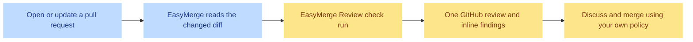

<p align="center">
  
</p>

<h1 align="center">EasyMerge</h1>

<p align="center">
  <strong>AI code review for every GitHub pull request.</strong><br />
  Inline comments, suggested fixes, and a merge-confidence score. Nothing to host.
</p>

<p align="center">
  <a href="https://easymerge.dev">Website</a> ·
  <a href="https://easymerge.dev/docs/overview/introduction">Documentation</a> ·
  <a href="../../issues">Feedback</a>
</p>

---

<p align="center">
  
</p>

## Review pull requests without changing your workflow

EasyMerge is a GitHub App that reviews pull requests with an LLM. Install it on
a repository and every non-draft pull request is reviewed automatically when it
is opened or updated. EasyMerge reviews the changed diff and anchors findings to
the relevant changed lines; it does not comment on untouched code.

There is no command to run, workflow file to add, or infrastructure to host.



## What you get

| Capability | How it helps |
| --- | --- |
| **Automatic PR reviews** | A review starts on a new pull request and on every new push. Drafts wait until they are ready for review. |
| **GitHub-native status** | An **EasyMerge Review** check run moves from queued to in progress, then reports its result on the head commit. |
| **One concise review** | A single GitHub review carries a recommendation, summary, finding counts, and, when available, a merge-confidence score. |
| **Inline, actionable findings** | Each finding is attached to its line or line range, includes a severity, and may include a GitHub-ready code suggestion. |
| **A live dashboard** | Watch reviews progress and browse current and past reviews without leaving EasyMerge. |
| **Configurable scope** | Exclude paths and adjust review settings per repository, while keeping defaults for generated code, lockfiles, bundles, and other non-reviewable files. |

## Beyond code review

| Capability | What it is designed to do |
| --- | --- |
| **Spec review** <sup>Pro</sup> | Compare a pull request diff with a configured text-based specification in the same repository or an authorized repository, then surface evidence-backed conflicts. It finds contradictions only; it does not certify completeness, block a merge, change code-review findings, or consume an additional review quota. |
| **Security Center** | Bring GitHub Dependabot dependency alerts for default branches into one place, with repository setup and coverage signals, next actions, and update-PR status. It distinguishes unavailable data or incomplete coverage from a clean security result, and does not run CI or a separate vulnerability scanner. |
| **Automations** | Schedule repository-level configuration checks and Dependabot metadata sync in a daily or weekly UTC window, then keep a run history. These schedules do not control GitHub security-update pull requests or run CI. |

## A review, at a glance

<details>
<summary><strong>Open an example EasyMerge review</strong></summary>

<br />

> [!CAUTION]
> **⛔ Recommendation: Blocked**
>
> The update route verifies that the caller is signed in, but does not verify
> that the project belongs to that user.

**1 finding across 1 file** ·  **Confidence: 4.6/10 · Low**

   · 

**`src/api/projects.ts`**

  · **Project ownership is not checked before update**

Any authenticated user who knows a project ID can update that project. Scope
the lookup to the current user before applying the change.

**Suggested change**

```suggestion
const project = await db.project.findFirst({
  where: { id: projectId, ownerId: user.id },
});

if (!project) return new Response("Not found", { status: 404 });
```

</details>

The GitHub review body collects the recommendation, written summary, finding
counts, and merge-confidence score. Each finding stays anchored to its changed
line; suggestions are proposals to review before committing.

### Severity badges

| Badge | Typical meaning |
| --- | --- |
|  | A severe security, correctness, crash, data-loss, or authentication problem. |
|  | A likely bug, edge case, resource leak, or significant performance issue. |
|  | A maintainability or smaller improvement. |

Pure formatting and style are left to your linter.

## Get started in three steps

1. **Sign in with GitHub.** After receiving access to EasyMerge, choose **Continue with GitHub**.
2. **Install the GitHub App.** Choose a personal account or organization, then grant access to all or selected repositories.
3. **Open a pull request.** The **EasyMerge Review** check appears shortly afterward; follow progress in GitHub or the dashboard.

That’s it. Read the [Quickstart](QUICKSTART.md) for a concise walkthrough,
or visit the [getting-started documentation](https://easymerge.dev/docs/getting-started/quickstart).

### Sensible defaults, adjustable per repository

| Default | Change it when needed |
| --- | --- |
|  +  comments | Choose which severities post inline. |
| Maximum inline comments | Set how many findings EasyMerge posts to a pull request. |
| Draft PRs wait | Review when the draft is ready. |
| Generated files, lockfiles, and bundles skipped | Add or remove exclude patterns. |

Info findings remain readable in the dashboard even when they are not posted
inline. Repository administrators can change these settings at any time.

## What EasyMerge does not do

| EasyMerge does | EasyMerge does not do |
| --- | --- |
| Review changed lines and post comments | Approve, block, or merge a PR |
| Add a GitHub check and review summary | Push commits or open PRs |
| Surface findings in the dashboard | Run tests, linters, or builds |
| Suggest an edit when it has a concrete fix | Review issues, wikis, or untouched code |

Keep merge controls in GitHub and automated verification in CI.

## Security and data handling

EasyMerge requests read access to repository contents and write access only
where it needs to publish pull-request reviews, comments, and check runs. It
does not request write access to source code and cannot push commits, create
branches, or merge pull requests.

Before installing, review the full
[GitHub permissions](https://easymerge.dev/docs/getting-started/install-github-app#permissions-requested),
[security and code privacy policy](https://easymerge.dev/docs/legal/security-and-code-privacy),
and [data and privacy reference](https://easymerge.dev/docs/reference/data-and-privacy).

## Documentation and support

- [Product documentation](https://easymerge.dev/docs/overview/introduction): installation, configuration, and guides.
- [Quickstart](QUICKSTART.md): a concise path from installation to your first review.
- [How it works](https://easymerge.dev/docs/overview/how-it-works): the path from push to posted comments.
- [Reading a review](https://easymerge.dev/docs/guides/reading-a-review): recommendations, severities, confidence, and suggestions.
- [Security and code privacy](https://easymerge.dev/docs/legal/security-and-code-privacy): how code is accessed, processed, and protected.
- [Data and privacy](https://easymerge.dev/docs/reference/data-and-privacy): stored data, retention, and deletion.
- [Support guide](https://easymerge.dev/docs/guides/support): help with account or private support requests.
- [GitHub Issues](../../issues): reproducible bugs and product ideas for this repository.

Please do not include credentials, tokens, private source code, or customer data
in public issues. For account-specific or sensitive requests, use the support
channel above.

## Releases

Product updates are published in the [EasyMerge changelog](https://easymerge.dev/changelog/).

## Links

[Website](https://easymerge.dev) · [Documentation](https://easymerge.dev/docs/overview/introduction) · [Changelog](https://easymerge.dev/changelog/)
