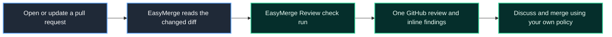

<p align="center">
  
</p>

<h1 align="center">EasyMerge</h1>

<p align="center">
  <strong>AI code review for every GitHub pull request.</strong><br />
  Inline comments, suggested fixes, and a merge-confidence score — nothing to host.
</p>

<p align="center">
  <a href="https://app.easymerge.dev"><strong>Open EasyMerge</strong></a> ·
  <a href="https://easymerge.dev">Website</a> ·
  <a href="https://easymerge.dev/docs/overview/introduction">Documentation</a> ·
  <a href="../../issues">Feedback</a>
</p>

---

<p align="center">
  
</p>

## Review pull requests without changing your workflow

EasyMerge is a GitHub App that reviews pull requests with an LLM. Install it on
a repository and every non-draft pull request is reviewed automatically when it
is opened or updated. EasyMerge reads only the changed lines in the diff; it
does not read the entire repository or comment on untouched code.

There is no command to run, workflow file to add, or infrastructure to host.



## At a glance

| Automatic reviews | Inline findings | Review status | Your existing workflow |
| :-: | :-: | :-: | :-: |
| Open a PR or push a commit. | A finding includes severity and context. | Follow the check in GitHub or the dashboard. | Keep your own reviewers, CI, and merge rules. |

## What you get

| Capability | How it helps |
| --- | --- |
| **Automatic PR reviews** | A review starts on a new pull request and on every new push. Drafts wait until they are ready for review. |
| **GitHub-native status** | An **EasyMerge Review** check run moves from queued to in progress, then reports its result on the head commit. |
| **One concise review** | A single GitHub review carries a recommendation, summary, finding counts, and—when available—a merge-confidence score. |
| **Inline, actionable findings** | Each finding is attached to its line or line range, includes a severity, and may include a GitHub-ready code suggestion. |
| **A live dashboard** | Watch reviews progress and browse current and past reviews without leaving EasyMerge. |
| **Configurable scope** | Exclude paths and adjust review settings per repository, while keeping defaults for generated code, lockfiles, bundles, and other non-reviewable files. |

## A review, at a glance

<details>
<summary><strong>Open an example EasyMerge review</strong></summary>

<br />

> [!WARNING]
> **Recommendation: Changes requested**
>
> A configuration value is read again on every request, which can add
> unnecessary work to the handler.

<p>
  
  
  
</p>

**`src/config.ts`**


**Config is re-read on every request**

This value does not change between requests. Create it once rather than inside
the request handler.

**Suggested change**

```suggestion
const compiled = compileTemplate(source);
```

</details>

The GitHub review body collects the recommendation, written summary, finding
counts, and confidence reading. Each finding stays anchored to its changed line;
suggestions are proposals to review before committing.

### Severity badges

| Badge | Typical meaning |
| --- | --- |
|  | A security, correctness, crash, data-loss, or authentication problem. |
|  | A likely bug, edge case, resource leak, or significant performance issue. |
|  | A maintainability or smaller improvement. |

Pure formatting and style are left to your linter.

## Get started in three steps

1. **Sign in with GitHub.** Open [EasyMerge](https://app.easymerge.dev) and choose **Continue with GitHub**.
2. **Install the GitHub App.** Choose a personal account or organisation, then grant access to all or selected repositories.
3. **Open a pull request.** The **EasyMerge Review** check appears within seconds; follow progress in GitHub or the dashboard.

That’s it. Read the [Quickstart](QUICKSTART.md) for the complete walkthrough,
or visit the [getting-started documentation](https://easymerge.dev/docs/getting-started/quickstart).

## What a typical review looks like

```text
1. Push a branch and open a pull request against the default branch.
2. Watch the EasyMerge Review check move from queued to in progress.
3. Read the single GitHub review: recommendation, summary, severity counts, and merge confidence.
4. Inspect each inline finding; where present, review and apply a suggested change directly in GitHub.
5. Push follow-up commits for a fresh review of the updated diff.
6. Use your normal team process to decide whether to merge.
```

### Sensible defaults, adjustable per repository

| Default | Change it when needed |
| --- | --- |
|  +  comments | Choose which severities post inline. |
| Maximum inline comments | Set how many findings EasyMerge posts to a pull request. |
| Draft PRs wait | Review when the draft is ready. |
| Generated files, lockfiles, and bundles skipped | Add or remove exclude patterns. |

Info findings remain readable in the dashboard even when they are not posted
inline. Repository administrators can change these settings at any time.

## What EasyMerge does not do

| EasyMerge does | EasyMerge does not do |
| --- | --- |
| Review changed lines and post comments | Approve, block, or merge a PR |
| Add a GitHub check and review summary | Push commits or open PRs |
| Surface findings in the dashboard | Run tests, linters, or builds |
| Suggest an edit when it has a concrete fix | Review issues, wikis, or untouched code |

Keep merge controls in GitHub and automated verification in CI.

<p align="center">
  
  <br />
  <strong>Ready for a first review?</strong><br />
  <a href="https://app.easymerge.dev">Sign in with GitHub</a>
</p>

## Documentation and support

- [Product documentation](https://easymerge.dev/docs/overview/introduction) — installation, configuration, and guides.
- [Quickstart](QUICKSTART.md) — a concise path from installation to your first review.
- [How it works](https://easymerge.dev/docs/overview/how-it-works) — the path from push to posted comments.
- [Reading a review](https://easymerge.dev/docs/guides/reading-a-review) — recommendations, severities, confidence, and suggestions.
- [Support guide](https://easymerge.dev/docs/guides/support) — help with account or private support requests.
- [GitHub Issues](../../issues) — reproducible bugs and product ideas for this repository.

Please do not include credentials, tokens, private source code, or customer data
in public issues. For account-specific or sensitive requests, use the support
channel above.

## Releases

Product updates are published in the [EasyMerge changelog](https://easymerge.dev/changelog/).
This repository's [CHANGELOG.md](CHANGELOG.md) points to the public release history.

## Links

[Website](https://easymerge.dev) · [Open the app](https://app.easymerge.dev) · [Documentation](https://easymerge.dev/docs/overview/introduction) · [Changelog](https://easymerge.dev/changelog/)
